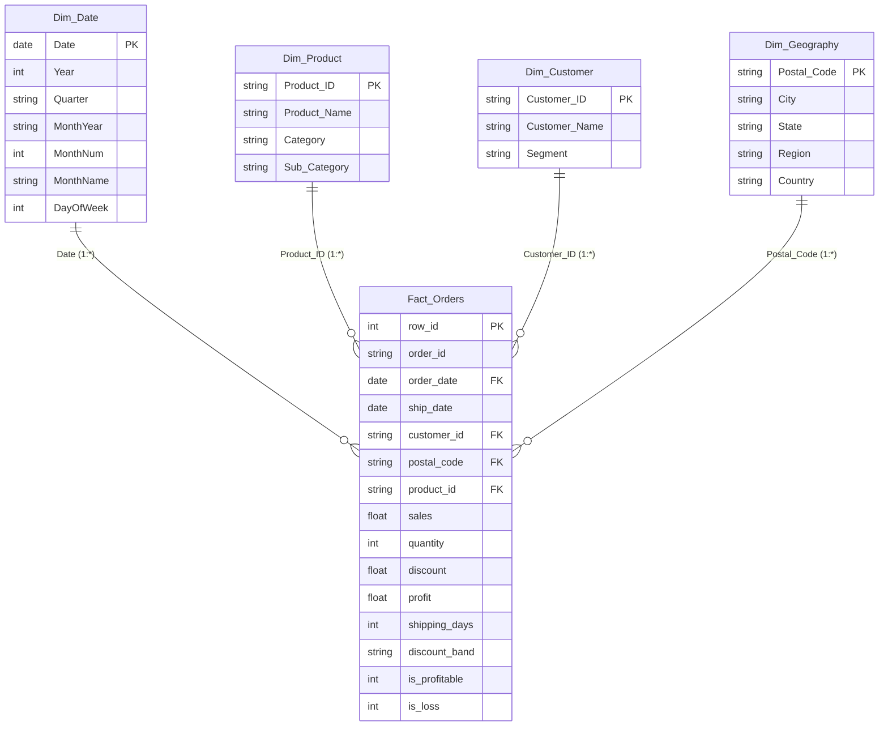

# Power BI Data Architecture & Star Schema Model

This document outlines the dimensional data model designed for the **Retail Intelligence — Sales & Profitability** Power BI report.

---

## 1. Dimensional Modeling Rationale (Star Schema)

While the flat transactional table `retail_orders_clean.csv` can be queried directly, enterprise Power BI architecture dictates a **Star Schema**:
1. **Performance & Compression:** The VertiPaq storage engine achieves optimal dictionary encoding and column compression when dimension tables contain unique business entities.
2. **Standardized Time Intelligence:** A dedicated, contiguous Date table (`Dim_Date`) marked as a Date Table is required for DAX functions like `SAMEPERIODLASTYEAR` and `YTD`.
3. **Filter Propagation:** One-to-many (`1:*`) single-direction relationships eliminate ambiguity, circular dependencies, and bidirectional filter degradation.



---

## 2. Table Specifications

### A. Fact Table: `Fact_Orders`
- **Source:** `data/processed/retail_orders_clean.csv` (or SQLite `retail_orders` table).
- **Grain:** One record per transactional line item (9,994 rows).
- **Foreign Keys:**
  - `order_date` $\rightarrow$ `Dim_Date[Date]`
  - `product_id` $\rightarrow$ `Dim_Product[Product_ID]`
  - `customer_id` $\rightarrow$ `Dim_Customer[Customer_ID]`
  - `postal_code` $\rightarrow$ `Dim_Geography[Postal_Code]`
- **Numeric Measures / Metrics:** `sales`, `quantity`, `discount`, `profit`, `shipping_days`, `unit_price`, `line_profit_margin`.
- **Classification Flags:** `is_profitable` (1/0), `is_loss` (1/0), `discount_band`.

### B. Dimension Table: `Dim_Date`
- **Power BI Configuration:** Mark as Date Table on column `Date`.
- **Span:** `2014-01-01` to `2017-12-31` (1,461 contiguous calendar days).
- **DAX Definition for Power BI:**
  ```dax
  Dim_Date = 
  ADDCOLUMNS (
      CALENDAR ( DATE ( 2014, 1, 1 ), DATE ( 2017, 12, 31 ) ),
      "Year", YEAR ( [Date] ),
      "Quarter", "Q" & FORMAT ( [Date], "Q" ),
      "YearQuarter", YEAR ( [Date] ) & "-Q" & FORMAT ( [Date], "Q" ),
      "MonthNum", MONTH ( [Date] ),
      "MonthName", FORMAT ( [Date], "mmmm" ),
      "MonthYear", FORMAT ( [Date], "yyyy-mm" ),
      "DayOfWeek", FORMAT ( [Date], "dddd" )
  )
  ```

### C. Dimension Table: `Dim_Product`
- **Granularity:** 1 row per unique product (1,862 distinct products).
- **DAX / Power Query Generation:**
  ```dax
  Dim_Product = 
  SUMMARIZE (
      Fact_Orders,
      Fact_Orders[product_id],
      Fact_Orders[product_name],
      Fact_Orders[category],
      Fact_Orders[sub_category]
  )
  ```

### D. Dimension Table: `Dim_Customer`
- **Granularity:** 1 row per customer account (793 distinct customers).
- **DAX / Power Query Generation:**
  ```dax
  Dim_Customer = 
  SUMMARIZE (
      Fact_Orders,
      Fact_Orders[customer_id],
      Fact_Orders[customer_name],
      Fact_Orders[segment]
  )
  ```

### E. Dimension Table: `Dim_Geography`
- **Granularity:** 1 row per distinct postal code / city / state / region combination.
- **DAX / Power Query Generation:**
  ```dax
  Dim_Geography = 
  SUMMARIZE (
      Fact_Orders,
      Fact_Orders[postal_code],
      Fact_Orders[city],
      Fact_Orders[state],
      Fact_Orders[region],
      Fact_Orders[country]
  )
  ```

---

## 3. Relationships & Model Properties

| From (Fact Table Foreign Key) | To (Dimension Table Primary Key) | Cardinality | Cross Filter Direction | Security / Enforcement |
| :--- | :--- | :--- | :--- | :--- |
| `Fact_Orders[order_date]` | `Dim_Date[Date]` | Many to One (`*:1`) | Single (`Dim_Date` filters `Fact_Orders`) | Active |
| `Fact_Orders[product_id]` | `Dim_Product[Product_ID]` | Many to One (`*:1`) | Single (`Dim_Product` filters `Fact_Orders`) | Active |
| `Fact_Orders[customer_id]` | `Dim_Customer[Customer_ID]` | Many to One (`*:1`) | Single (`Dim_Customer` filters `Fact_Orders`) | Active |
| `Fact_Orders[postal_code]` | `Dim_Geography[Postal_Code]`| Many to One (`*:1`) | Single (`Dim_Geography` filters `Fact_Orders`)| Active |

> **Architectural Rule:**  
> Never enable bi-directional filtering between dimensions and the fact table. All slicers and visual cross-filters should flow naturally downstream through standard single-direction relationships.
